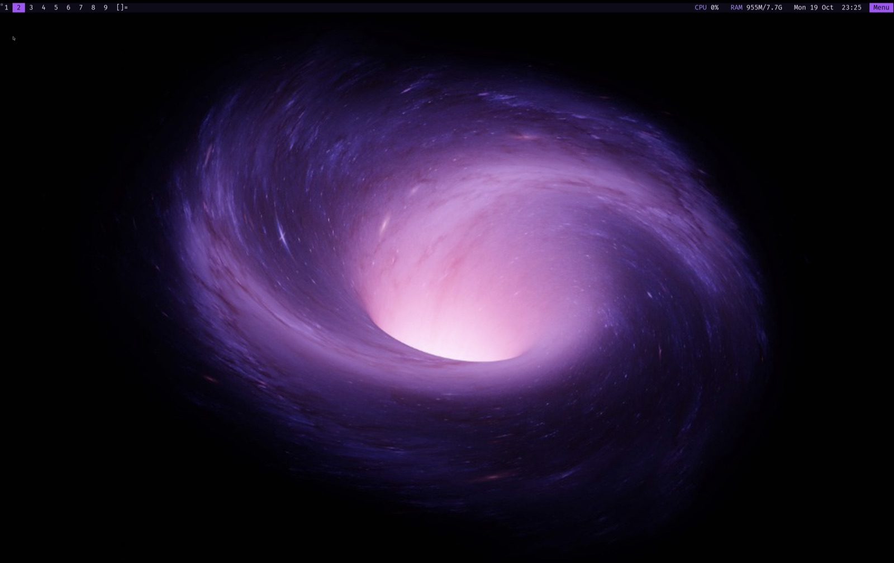
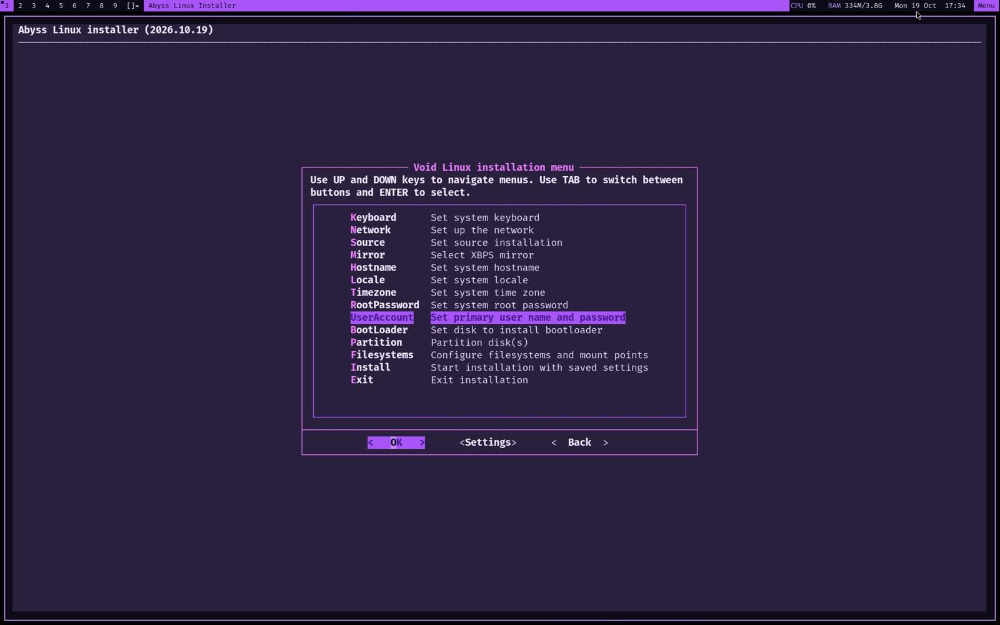
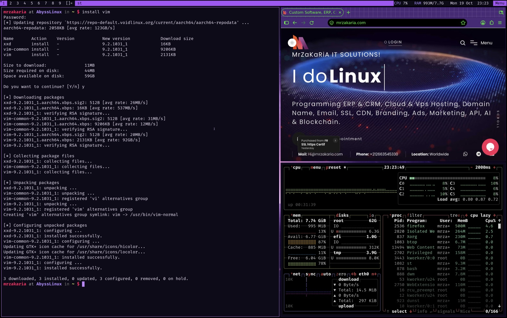

<div align="center">

# Abyss Linux

**A lightweight, rolling-release, systemd-free desktop built on Void Linux and the suckless tools.**

[](https://github.com/MrZaKaRiA/AbyssLinux/releases/latest)
[](https://github.com/MrZaKaRiA/AbyssLinux/releases)


-a855f7)
[](LICENSE)



</div>

---

## Contents

- [The story](#the-story)
- [Why Void Linux and suckless fit together](#why-void-linux-and-suckless-fit-together)
- [Download v27.3](#download-v273)
- [Install](#install)
- [The desktop](#the-desktop)
- [Keyboard and mouse](#keyboard-and-mouse)
- [Software](#software)
- [Updates and the Abyss package repository (PMR)](#updates-and-the-abyss-package-repository-pmr)
- [Building the ISO from source](#building-the-iso-from-source)
- [Repository layout](#repository-layout)
- [Contributing](#contributing)
- [Credits and license](#credits-and-license)

---

## The story

For years I hopped from distribution to distribution looking for a daily driver that fit how I work. I write code, run servers, design, and spend most of the day in a terminal. What I wanted turned out to be a short list of hard requirements:

* **It has to suck less.** I wanted small programs I can read in an afternoon, configure in C, and understand completely. The [suckless](https://suckless.org/philosophy/) philosophy of simplicity, clarity and frugality is how I want my tools to behave.
* **Rolling release.** No big-bang upgrades every six months, and nothing frozen two years behind upstream. I wanted to update when I like and always have current software.
* **No systemd.** I wanted an init I can understand: a few shell scripts and a supervisor, not a whole platform.
* **Minimalist by default.** I wanted to start from almost nothing and add only what I need.
* **Not a fork.** I didn't want a rebrand of Ubuntu or Arch that lags behind its parent and dies when its maintainer gets bored. I wanted something independent, with its own package manager and build system.

Most distributions fail at least one of these. Some are rolling but run systemd. Some are minimal but are forks of forks. Some are systemd-free but fixed-release.

Then I found **[Void Linux](https://voidlinux.org)**, and it met every one:

* An **independent** distribution, built from scratch and not derived from any other.
* **Rolling release**, with packages that track upstream closely.
* **runit** as init and service supervisor. A service is a directory with a `run` script, and boot takes seconds.
* **XBPS**, a fast, simple binary package manager, plus `xbps-src`, a clean source-build system that anyone can use to package and patch software.
* A **minimal base** that installs only what you ask for.

On top of that base I built my daily desktop from the suckless tools: **dwm**, **st**, **dmenu**, **slock** and **tabbed**. Over time the patches, the configuration, the scripts and the small fixes added up to a complete, polished system that I install everywhere: on my Mac through Apple Virtualization, on x86_64 machines, and in VMs.

**Abyss Linux** is that system, packaged so anyone can use it. It's a ready-to-boot ISO for people who like minimalist, efficient computing and want a beautiful, fast, understandable desktop without spending weeks building it themselves. It stays 100% Void underneath: the official Void repositories, Void's kernel and Void's tools. Abyss only adds a desktop layer and a small signed repository for its suckless builds.

---

## Why Void Linux and suckless fit together

| | Void Linux | suckless | Together |
|---|---|---|---|
| **Philosophy** | Do one thing, keep the base minimal | Simple, clear, frugal code | Nothing runs that you didn't ask for |
| **Configuration** | Plain files in `/etc`, runit service dirs | `config.h`, compiled in | All configuration is readable text |
| **Size** | ~600 MB base system | dwm is ~2000 lines of C | The idle desktop uses roughly 300 MB of RAM |
| **Patching** | `xbps-src` templates take a `patches/` directory | Features ship as `.diff` patches | A patched dwm is just a template and two patch files |
| **Updates** | Rolling, `xbps-install -Su` | Small releases, easy to rebase | New suckless releases arrive through the Abyss PMR without a new ISO |
| **Init** | runit: no systemd, no logind lock-in (elogind optional) | No dependencies on desktop frameworks | Fast boot, nothing hidden |

Void already packages the suckless tools. Its `xbps-src` system makes it easy to rebuild them with patches applied and publish them as normal binary packages. That is exactly what the **[Abyss Linux PMR](https://github.com/MrZaKaRiA/AbyssLinuxPMR)** does.

---

## Download v27.3

<p align="center">
  <a href="https://github.com/MrZaKaRiA/AbyssLinux/releases"></a>
  <a href="https://github.com/MrZaKaRiA/AbyssLinux/releases/tag/v27.3"></a>
</p>

| File | Architecture | For | Size | SHA-256 |
|---|---|---|---|---|
| [`abyss-linux-27.3-aarch64.iso`](https://github.com/MrZaKaRiA/AbyssLinux/releases/download/v27.3/abyss-linux-27.3-aarch64.iso) | ARM64 (aarch64), UEFI | Apple Silicon Macs (Apple Virtualization, UTM, Parallels, QEMU), ARM64 servers and boards with UEFI | 1.38 GiB | `ee190bbd21ccb7e5b11fb77ab1f390116df88d2456b408460ed6ceb27320897a` |
| [`abyss-linux-27.3-x86_64.iso`](https://github.com/MrZaKaRiA/AbyssLinux/releases/download/v27.3/abyss-linux-27.3-x86_64.iso) | x86-64, UEFI and BIOS | PCs, laptops, VirtualBox, VMware, QEMU/KVM, Hyper-V | 1.39 GiB | `f704e7622eb10055e5ea5a05040ffb9294d8096c6f46a2db18ab667b42482bd0` |

[`SHA256SUMS`](https://github.com/MrZaKaRiA/AbyssLinux/releases/download/v27.3/SHA256SUMS) · [what's new in 27.3](https://github.com/MrZaKaRiA/AbyssLinux/releases/tag/v27.3) · [older releases](https://github.com/MrZaKaRiA/AbyssLinux/releases)

Verify a download:

```sh
sha256sum -c SHA256SUMS            # Linux
shasum -a 256 -c SHA256SUMS        # macOS
```

**Requirements:** 2 CPU cores, 2 GB RAM (4 GB recommended), 16 GB disk, UEFI firmware (aarch64) or UEFI/BIOS (x86_64). In a VM, give it a virtio GPU, virtio disk and virtio network if you can.

**ARM boot note:** In QEMU, the ARM image displayed missing GRUB `usbms` and `usb_keyboard` module warnings before continuing to the desktop. Boot-menu keyboard behavior on physical ARM hardware has not been verified.

**Live session:** boots into the desktop as user `anon` (password `voidlinux`; root password `voidlinux`). The hostname is `abyss-live` and the ISO label is `ABYSS_LIVE`.

---

## Install

1. Boot the ISO and wait for the live desktop. Boot-menu appearance depends on the firmware and boot mode.
2. Click **Menu** (top-right) → **Install Abyss Linux**. The installer opens in its own large terminal window with a dark, high-contrast theme.
3. Set **Hostname**, **RootPassword** and **UserAccount**, then choose **Partition → auto**. This creates:
   * a GPT table,
   * a 1 GB FAT32 EFI system partition on `/boot/efi`,
   * the rest as an ext4 root `/`,
   * the bootloader target, set automatically.
4. Choose **Install**. The live system is copied to disk (the *Local* source, so no network is needed), GRUB is installed (with a removable `EFI/BOOT` fallback so it boots in VMs that forget NVRAM entries), and services are enabled.
5. Reboot and remove the ISO. LightDM shows the Abyss login screen; after signing in, the desktop starts.



The installer is Void's `void-installer` with Abyss changes: one-step automatic UEFI partitioning, a dark theme (`/etc/dialogrc`), Abyss branding, and the live autologin user removed from the installed system.

---

## The desktop



* **dwm**, patched with systray, status2d, vanitygaps, scratchpad, attachaside and autostart, and themed in Abyss purple `#a855f7` on `#0d0b18`.
* **A small status bar** (`dwm-statusbar`): network type and transfer rate, battery when present, volume when audio is installed, CPU, RAM, clock, and the Menu button.
* **A searchable dmenu control center.** Click the bar or press `Super+Esc` to open settings, the package browser, first-run setup, display controls, and power actions.
* **On-demand software.** The ISO contains no general-purpose apps. Install Firefox, Chrome, QEMU/virt-manager, Docker, VLC, PipeWire, VS Code, ArtCraft Launcher, Ollama, Claude Code, OpenCode, Cursor, or browse Void packages from the software window.
* **First-run setup.** Choose keyboard layouts, enable optional Void repositories, and start optional runit services only when needed.
* **HiDPI and displays.** Abyss sets a reasonable Xft scale from the largest connected display, remembers resolution and refresh-rate choices, and offers a left-to-right multi-monitor layout. Mixed-DPI scaling depends on Xorg's global DPI behavior.
* **OLED option.** The desktop background is true black. Display settings can blank an idle screen after ten minutes.
* **Hardware support.** XRandR exposes modes provided by the graphics driver, including high refresh rates. Standard USB keyboards, mice, and storage use Void's kernel support; install the optional external-drive tools for graphical mounting. USB-C display output and docks remain dependent on the device, firmware, GPU, and dock.

The desktop uses the Abyss purple palette with the upstream-based `dwm`, `st`, `dmenu`, `slock`, and `tabbed` packages. Additional applications remain ordinary Void packages or vendor downloads installed on demand.

---

## Keyboard and mouse

`Super` is the mod key. Press `Super+F1` at any time for the cheatsheet.

### dwm (compiled into `config.h`)

| Keys | Action |
|---|---|
| `Super+Return` | Terminal (st) |
| `Super+Alt+Return` | Alacritty |
| ``Super+` `` | Scratchpad terminal (toggle) |
| `Super+p` | dmenu run |
| `Super+Esc` | Abyss menu |
| `Super+F1` | Keyboard cheatsheet |
| `Super+b` / `Super+c` / `Super+v` | Browser / VS Code / virt-manager |
| `Super+s` | SSH manager (dmenu-ssh) |
| `Super+Shift+l` | Lock screen (slock) |
| `Super+j` / `Super+k` (or `Super+↓` / `Super+↑`) | Focus next / previous window |
| `Super+Shift+j` / `Super+Shift+k` (or `Super+Shift+↓` / `↑`) | **Move the window** down / up the stack |
| `Super+h` / `Super+l` | Shrink / grow master area |
| `Super+i` / `Super+d` | More / fewer windows in master |
| `Super+Shift+Return` | Promote window to master |
| `Super+Shift+c` | Close window |
| `Super+t` / `Super+f` / `Super+m` | Tile / floating / monocle layout |
| `Super+Space` / `Super+Shift+Space` | Previous layout / toggle floating |
| `Super+←` / `Super+→` | Previous / next desktop (tag) |
| `Super+Shift+←` / `Super+Shift+→` | **Move the window** to the previous / next desktop and follow it |
| `Super+1…9` | View tag |
| `Super+Shift+1…9` | Move window to tag |
| `Super+Ctrl+1…9` | Toggle tag view |
| `Super+0` / `Super+Shift+0` | View all tags / sticky window |
| `Super+Tab` | Last tag |
| `Super+,` / `Super+.` | Focus monitor |
| `Super+Shift+,` / `Super+Shift+.` | Move window to monitor |
| `Super+Alt+0` | Toggle gaps |
| `Super+Alt+=` / `Super+Alt+-` | Larger / smaller gaps |
| `Super+Alt+Shift+0` | Reset gaps |
| `Super+Shift+b` | Toggle bar |
| `Super+Shift+q` | Quit dwm |

Optional applications are installed from **Menu → Install software**. The base ISO does not run an extra hotkey daemon; dwm handles the bundled shortcuts directly.

### Mouse

| Where | Click | Action |
|---|---|---|
| Status bar / Menu | left or right | Abyss menu |
| Status bar | middle | Terminal |
| Tag | left / right | View / toggle tag |
| Window + `Super` | left / middle / right drag | Move / toggle floating / resize |

---

## Software

### The suckless core (Abyss builds, from the [PMR](https://github.com/MrZaKaRiA/AbyssLinuxPMR))

| Package | Upstream | Patches and changes | Purpose |
|---|---|---|---|
| `abyss-dwm` 6.8_3 | dwm 6.8 + git `bca7cf2` | [systray](https://dwm.suckless.org/patches/systray/), [status2d](https://dwm.suckless.org/patches/status2d/), [vanitygaps](https://dwm.suckless.org/patches/vanitygaps/), [scratchpad](https://dwm.suckless.org/patches/scratchpad/), [attachaside](https://dwm.suckless.org/patches/attachaside/), [autostart](https://dwm.suckless.org/patches/autostart/), [movestack](https://dwm.suckless.org/patches/movestack/), [shiftview](https://dwm.suckless.org/patches/shiftview/) (+ shifttag); Abyss theme; status click → menu | Tiling window manager |
| `abyss-st` 0.9.3_1 | st 0.9.3 + git `fdaadd5` | [clipboard](https://st.suckless.org/patches/clipboard/); Abyss 16-colour palette; font in points (`size=11`) for HiDPI | Terminal |
| `abyss-dmenu` 5.4_1 | dmenu 5.4 + git `8627d0c` | [center](https://tools.suckless.org/dmenu/patches/center/) `-c`, [border](https://tools.suckless.org/dmenu/patches/border/) `-bw`, [line-height](https://tools.suckless.org/dmenu/patches/line-height/) `-h`, [password](https://tools.suckless.org/dmenu/patches/password/) `-P`, case-insensitive by default; Abyss colours | Menu / launcher |
| `abyss-slock` 1.7_1 | slock 1.7 + git `65cb721` | config: privilege-drop group, colours | Screen locker |
| `abyss-tabbed` 0.9_1 | tabbed 0.9 + git `e65146d` | config: font, colours | XEmbed tabs |
| `abyss-wmname` 0.1_1 | wmname 0.1 + git `1114a83` | none | `wmname LG3D` for Java GUI apps |
| `abyss-theme` 1.0_1 | Abyss | GTK 3 theme "Abyss" (Adwaita dark + Abyss palette), icon theme "Abyss" (Papirus-Dark, violet folders) | Dark Thunar and GTK apps |

The patched source trees are in this repository (`dwm/`, `st/`, `dmenu/`, `slock/`, `tabbed/`, `wmname/`). The PMR holds the same changes as patch files against the official release tarballs.

### Minimal Void foundation

The ISO includes Void's rolling base, kernel and firmware, XBPS, the graphical login and Xorg, networking, installer dependencies, and the runtime utilities needed by the Abyss desktop. It does not preinstall browsers, editors, media players, file managers, developer toolchains, VM suites, AI tools, or creative applications.

The desktop packages are Abyss builds of upstream suckless tools: `abyss-dwm`, `abyss-st`, `abyss-dmenu`, `abyss-slock`, `abyss-tabbed`, and `abyss-wmname`. Their templates and patches live in the signed Abyss PMR; the Void base continues to update from Void's repositories.

### Install applications when you need them

Open **Menu → Install software** to install common options from Void or download a vendor's current release. The list includes Firefox, Google Chrome, Chromium, QEMU with virt-manager, Docker Engine, VLC, PipeWire, Bluetooth tools, VS Code, ArtCraft Launcher, Ollama, Claude Code, OpenCode, Cursor, and ChatGPT in the browser. Use **Search Void packages** to install other packages from enabled XBPS repositories.

Some vendor installers are supported only on particular distributions. The installer uses official download sources and clearly marks browser-only links where a vendor does not provide a Void-compatible package. System packages stay managed by XBPS; vendor applications follow the vendor's update method.

### Abyss's own pieces

| File | Purpose |
|---|---|
| `/usr/local/bin/abyss-control-center` | Searchable dmenu control center and settings |
| `/usr/local/bin/abyss-software` | Online Void package browser and current vendor installers |
| `/usr/local/bin/abyss-setup` | First-run keyboard, repositories, services, display settings |
| `/usr/local/bin/abyss-display` | RandR mode, refresh, multi-monitor and OLED blanking controls |
| `/usr/local/bin/abyss-installer` | Opens `void-installer` as root in a big st window with the Abyss accent |
| `/usr/local/bin/abyss-launcher` | Search installed apps and commands with dmenu |
| `/usr/local/bin/abyss-keyboard` | Layouts, Caps→Esc, Super-on-Alt swap, `--status`, `--test` |
| `/usr/local/bin/abyss-shortcuts` | Cheatsheet (`Super+F1`) |
| `/usr/local/bin/dwm-statusbar` | Status text |
| `/usr/local/bin/dmenu-ssh` | Pick or type an SSH host |
| `/usr/bin/void-installer` | Installer with auto-partitioning and Abyss fixes |
| `/etc/dialogrc` | Dark installer theme |
| `/etc/xbps.d/20-abyss-pmr.conf` | Adds the Abyss PMR |
| `/etc/skel/…` | `.xinitrc`, `.Xresources`, `.vimrc`, `.bashrc`, keyboard and monitor profiles |

The full list with file modes is in [docs/abyss-overlay.md](docs/abyss-overlay.md).

---

## Updates and the Abyss package repository (PMR)

Abyss is a rolling release. One command updates XBPS-managed packages from Void and the Abyss PMR. Apps installed directly from vendors may need their own update method.

```sh
doas xbps-install -Su
```

The suckless tools come from the **[Abyss Linux PMR](https://github.com/MrZaKaRiA/AbyssLinuxPMR)**. It's a signed XBPS repository, built from public `xbps-src` templates by GitHub Actions and hosted on GitHub Pages:

```
repository = https://mrzakaria.github.io/AbyssLinuxPMR/current      (/etc/xbps.d/20-abyss-pmr.conf)
signing key = c6:f0:d1:05:cb:f1:89:83:58:c2:e2:e4:4c:c9:09:9a        (RSA 4096, "Abyss Linux")
```

When suckless releases a new dwm or st, or someone improves a patch, a pull request to the PMR updates the template. CI rebuilds and signs it, and every Abyss system receives it with the next `xbps-install -Su`. You don't need a new ISO.

```sh
xbps-query -Rs abyss-                 # what the PMR offers
xbps-query -p repository abyss-dwm    # where an installed package came from
```

---

## Building the ISO from source

The build uses Void's [void-mklive](https://github.com/void-linux/void-mklive) (vendored in `void-mklive/` with the Abyss installer changes) and runs on:

* **macOS (Apple Silicon):** `build-distro.sh` boots a small Void Linux VM with QEMU + HVF and builds inside it. Requires `qemu`, `e2fsprogs` and `python3` from Homebrew, and about 15 GB of free disk.
* **Void Linux:** runs `mklive.sh` directly (as root).

```sh
git clone https://github.com/MrZaKaRiA/AbyssLinux && cd AbyssLinux
FORCE_REBUILD=1 ./build-distro.sh                 # aarch64 + x86_64
FORCE_REBUILD=1 BUILD_X86_64=0 ./build-distro.sh  # aarch64 only
```

Output: `void-suckless-dev-aarch64.iso` and `void-suckless-dev-x86_64.iso`. The release renames them to `abyss-linux-<version>-<arch>.iso`.

What the build does:

1. `builder/setup-builder.sh` (macOS only) downloads a Void aarch64 rootfs and kernel to `/tmp/void-builder`.
2. `builder/abyss-mklive-tweaks.sh` patches a *copy* of void-mklive: hidden 2 s GRUB menu, ISO label `ABYSS_LIVE`, hostname `abyss-live`, and the Abyss PMR key in `keys/`.
3. `mklive.sh` installs the minimal package list from the Void repos **and the Abyss PMR** (`-r`), copies `custom-overlay/` over the rootfs, enables only core services, and runs `builder/abyss-postsetup.sh`. That hook sets root ownership and modes, writes the version into the installer and `/etc/os-release`, and reports missing tools.
4. dracut builds the live initramfs, and xorriso makes a hybrid ISO with the Abyss GRUB splash. The kernel command line is `quiet loglevel=3 rd.udev.log_level=3 udev.log_level=3`.

Rebuild a suckless binary for local testing by editing `dwm/config.def.h` (for example) and building it like any suckless program (`make`). Ship the change through the PMR (see [CONTRIBUTING.md](CONTRIBUTING.md)).

---

## Repository layout

```
AbyssLinux/
├── README.md, CHANGELOG.md, CONTRIBUTING.md, LICENSE, VERSION
├── build-distro.sh            # entry point (macOS → QEMU builder VM, Linux → mklive)
├── builder/
│   ├── builder.sh             # runs inside the builder VM (packages, services, mklive calls)
│   ├── setup-builder.sh       # fetches the builder VM rootfs + kernel (macOS)
│   ├── abyss-mklive-tweaks.sh # boot/branding tweaks + PMR key on a void-mklive copy
│   └── abyss-postsetup.sh     # mklive -x hook: ownership, modes, version
├── keys/abyss-pmr.plist       # public key of the Abyss PMR (fingerprint in keys/FINGERPRINT)
├── custom-overlay/            # files copied onto the ISO root filesystem
│   ├── etc/ (skel, sv, xbps.d, X11, dialogrc, doas.conf, rc.conf, os-release, …)
│   └── usr/ (bin/void-installer, local/bin/abyss-*, share/backgrounds/abyss, …)
├── dwm/ st/ dmenu/ slock/ tabbed/ wmname/   # patched suckless sources (as shipped)
├── void-mklive/               # Void's live-image builder + Abyss installer changes
└── docs/ (abyss-overlay.md, screenshots/)
```

---

## Contributing

Bug reports, fixes, new patches and ideas are welcome. See [CONTRIBUTING.md](CONTRIBUTING.md).

* Desktop, scripts, installer and build → this repository.
* Suckless builds and new Abyss packages → [AbyssLinuxPMR](https://github.com/MrZaKaRiA/AbyssLinuxPMR).

---

## Credits and license

* [Void Linux](https://voidlinux.org) and its contributors: the base system, XBPS, xbps-src and void-mklive (BSD-2-Clause, see `void-mklive/COPYING`).
* [suckless.org](https://suckless.org): dwm, st, dmenu, slock, tabbed and wmname (MIT/X, see each `LICENSE`), and the authors of every patch listed above.
* Everything else in this repository (scripts, overlay, build hooks, documentation) is MIT licensed. See [LICENSE](LICENSE).

Abyss Linux is a community project and is not affiliated with Void Linux or suckless.org.

---

<div align="center">

© 2026 Abyss Linux · Made with 💜 & <a href="https://voidlinux.org">Void Linux</a> & <a href="https://suckless.org">Suckless</a> · By <a href="https://mrzakaria.com">MrZaKaRiA</a>

</div>
