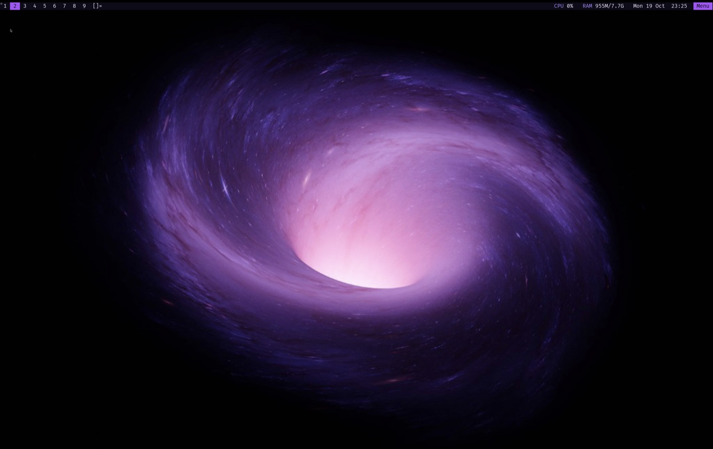
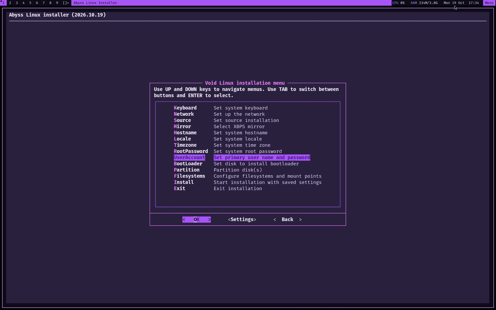
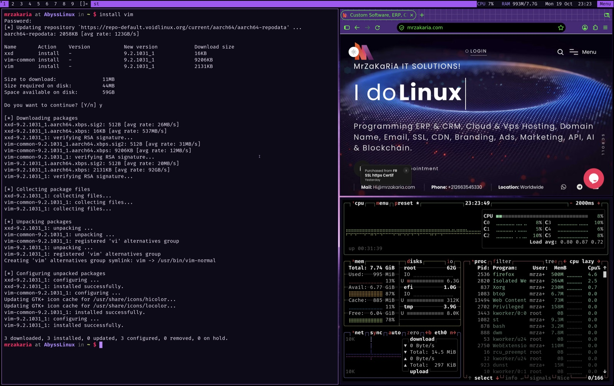
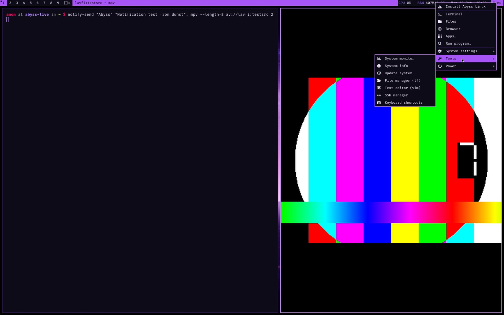
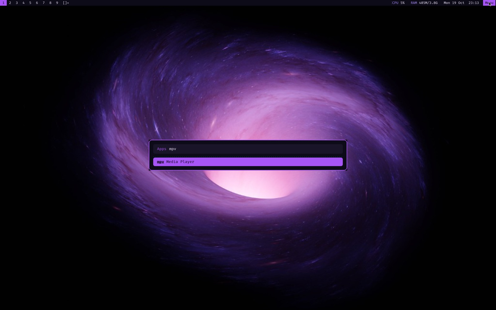
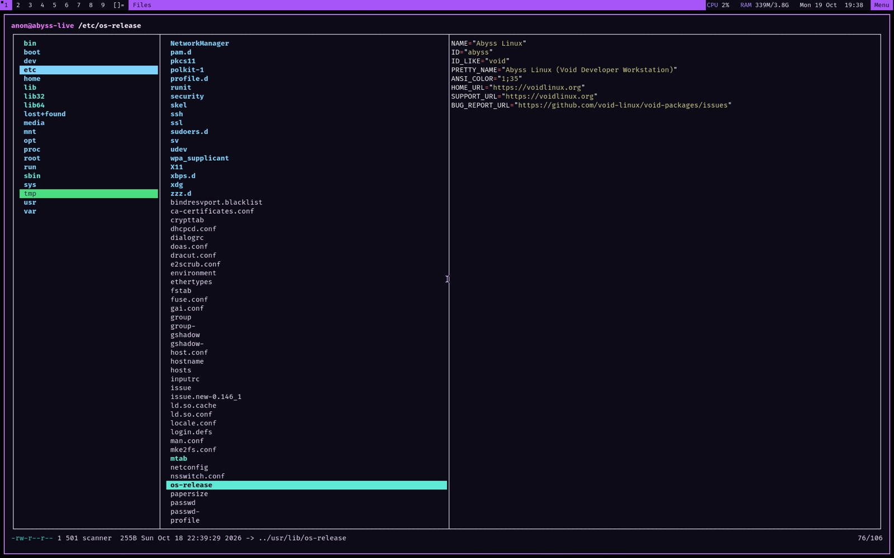

<div align="center">

# Abyss Linux

**A minimalist, rolling-release, systemd-free desktop built on Void Linux and the suckless tools.**

[](https://github.com/MrZaKaRiA/AbyssLinux/releases/latest)
[](https://github.com/MrZaKaRiA/AbyssLinux/releases)


-a855f7)
[](LICENSE)



</div>

---

## Contents

- [The story](#the-story)
- [Why Void Linux and suckless fit together](#why-void-linux-and-suckless-fit-together)
- [Download v27.1](#download-v271)
- [Install](#install)
- [The desktop](#the-desktop)
- [Keyboard and mouse](#keyboard-and-mouse)
- [Software](#software)
- [Updates and the Abyss package repository (PMR)](#updates-and-the-abyss-package-repository-pmr)
- [Building the ISO from source](#building-the-iso-from-source)
- [Repository layout](#repository-layout)
- [Contributing](#contributing)
- [Credits and license](#credits-and-license)

---

## The story

For years I hopped from distribution to distribution looking for a daily driver that fit how I work. I write code, run servers, design, and spend most of the day in a terminal. What I wanted turned out to be a short list of hard requirements:

* **It has to suck less.** I wanted small programs I can read in an afternoon, configure in C, and understand completely. The [suckless](https://suckless.org/philosophy/) philosophy of simplicity, clarity and frugality is how I want my tools to behave.
* **Rolling release.** No big-bang upgrades every six months, and nothing frozen two years behind upstream. I wanted to update when I like and always have current software.
* **No systemd.** I wanted an init I can understand: a few shell scripts and a supervisor, not a whole platform.
* **Minimalist by default.** I wanted to start from almost nothing and add only what I need.
* **Not a fork.** I didn't want a rebrand of Ubuntu or Arch that lags behind its parent and dies when its maintainer gets bored. I wanted something independent, with its own package manager and build system.

Most distributions fail at least one of these. Some are rolling but run systemd. Some are minimal but are forks of forks. Some are systemd-free but fixed-release.

Then I found **[Void Linux](https://voidlinux.org)**, and it met every one:

* An **independent** distribution, built from scratch and not derived from any other.
* **Rolling release**, with packages that track upstream closely.
* **runit** as init and service supervisor. A service is a directory with a `run` script, and boot takes seconds.
* **XBPS**, a fast, simple binary package manager, plus `xbps-src`, a clean source-build system that anyone can use to package and patch software.
* A **minimal base** that installs only what you ask for.

On top of that base I built my daily desktop from the suckless tools: **dwm**, **st**, **dmenu**, **slock** and **tabbed**. Over time the patches, the configuration, the scripts and the small fixes added up to a complete, polished system that I install everywhere: on my Mac through Apple Virtualization, on x86_64 machines, and in VMs.

**Abyss Linux** is that system, packaged so anyone can use it. It's a ready-to-boot ISO for people who like minimalist, efficient computing and want a beautiful, fast, understandable desktop without spending weeks building it themselves. It stays 100% Void underneath: the official Void repositories, Void's kernel and Void's tools. Abyss only adds a desktop layer and a small signed repository for its suckless builds.

---

## Why Void Linux and suckless fit together

| | Void Linux | suckless | Together |
|---|---|---|---|
| **Philosophy** | Do one thing, keep the base minimal | Simple, clear, frugal code | Nothing runs that you didn't ask for |
| **Configuration** | Plain files in `/etc`, runit service dirs | `config.h`, compiled in | All configuration is readable text |
| **Size** | ~600 MB base system | dwm is ~2000 lines of C | The idle desktop uses roughly 300 MB of RAM |
| **Patching** | `xbps-src` templates take a `patches/` directory | Features ship as `.diff` patches | A patched dwm is just a template and two patch files |
| **Updates** | Rolling, `xbps-install -Su` | Small releases, easy to rebase | New suckless releases arrive through the Abyss PMR without a new ISO |
| **Init** | runit: no systemd, no logind lock-in (elogind optional) | No dependencies on desktop frameworks | Fast boot, nothing hidden |

Void already packages the suckless tools. Its `xbps-src` system makes it easy to rebuild them with patches applied and publish them as normal binary packages. That is exactly what the **[Abyss Linux PMR](https://github.com/MrZaKaRiA/AbyssLinuxPMR)** does.

---

## Download v27.1

<p align="center">
  <a href="https://github.com/MrZaKaRiA/AbyssLinux/releases"></a>
  <a href="https://github.com/MrZaKaRiA/AbyssLinux/releases/tag/v27.1"></a>
</p>

| File | Architecture | For | Size | SHA-256 |
|---|---|---|---|---|
| [`abyss-linux-27.1-aarch64.iso`](https://github.com/MrZaKaRiA/AbyssLinux/releases/download/v27.1/abyss-linux-27.1-aarch64.iso) | ARM64 (aarch64), UEFI | Apple Silicon Macs (Apple Virtualization, UTM, Parallels, QEMU), ARM64 servers and boards with UEFI | 1.62 GiB | `50707aae83246c3462a43b479795db075bb3f606aed3f56c0a76e7730609f4f7` |
| [`abyss-linux-27.1-x86_64.iso`](https://github.com/MrZaKaRiA/AbyssLinux/releases/download/v27.1/abyss-linux-27.1-x86_64.iso) | x86-64, UEFI and BIOS | PCs, laptops, VirtualBox, VMware, QEMU/KVM, Hyper-V | 1.64 GiB | `ed8c50ef449a5ab9c05ac7b44ce2f91db942d073fb59ba2820c0b3b7b7e0cf97` |

[`SHA256SUMS`](https://github.com/MrZaKaRiA/AbyssLinux/releases/download/v27.1/SHA256SUMS) · [what's new in 27.1](https://github.com/MrZaKaRiA/AbyssLinux/releases/tag/v27.1) · [older releases](https://github.com/MrZaKaRiA/AbyssLinux/releases)

Verify a download:

```sh
sha256sum -c SHA256SUMS            # Linux
shasum -a 256 -c SHA256SUMS        # macOS
```

**Requirements:** 2 CPU cores, 2 GB RAM (4 GB recommended), 16 GB disk, UEFI firmware (aarch64) or UEFI/BIOS (x86_64). In a VM, give it a virtio GPU, virtio disk and virtio network if you can.

**Live session:** boots through the Abyss splash straight into the desktop as user `anon` (password `voidlinux`; root password `voidlinux`). The hostname is `abyss-live` and the ISO label is `ABYSS_LIVE`.

---

## Install

1. Boot the ISO. The boot is silent (no GRUB menu; hold **Esc** or **Shift** to see it) and lands on the desktop.
2. Click **Menu** (top-right) → **Install Abyss Linux**. The installer opens in its own large terminal window with a dark, high-contrast theme.
3. Set **Hostname**, **RootPassword** and **UserAccount**, then choose **Partition → auto**. This creates:
   * a GPT table,
   * a 1 GB FAT32 EFI system partition on `/boot/efi`,
   * the rest as an ext4 root `/`,
   * the bootloader target, set automatically.
4. Choose **Install**. The live system is copied to disk (the *Local* source, so no network is needed), GRUB is installed (with a removable `EFI/BOOT` fallback so it boots in VMs that forget NVRAM entries), and services are enabled.
5. Reboot, remove the ISO, log in on tty1, and the desktop starts automatically.



The installer is Void's `void-installer` with Abyss changes: one-step automatic UEFI partitioning, a dark theme (`/etc/dialogrc`), Abyss branding, a clean tty1 login on the installed system (the live autologin user is removed), and the correct package clean-up order.

---

## The desktop



* **dwm**, patched with systray, status2d, vanitygaps, scratchpad, attachaside and autostart, and themed in Abyss purple `#a855f7` on `#0d0b18`.
* **A minimal status bar** (`dwm-statusbar`): CPU, RAM and the clock, plus `offline` when there is no network, and a purple **Menu** button.
* **The Abyss menu** (`abyss-control-center`, xmenu). Click Menu, or press `Super+Esc`. Everything is one tree: Apps, Files, Browser, System settings (network, audio, displays, keyboard, wallpaper), Tools (monitor, update, lf, vim, SSH manager, shortcuts) and Power (lock, suspend, hibernate, exit, reboot, shut down). A flat, searchable dmenu version is the fallback.
* **HiDPI out of the box.** `~/.xinitrc` sets `Xft.dpi` to 192 (2×) in Apple Virtualization guests and on screens at least 1700 px tall, and to 144 (1.5×) from 1300 px. dwm, st, dmenu, xmenu, rofi and dunst all scale with it. To pin a value: `echo 144 > ~/.config/abyss/dpi`.
* **Keyboard:** `us` + `ara` layouts (Alt+Shift switches), Caps Lock is Escape, and `Super+Alt+k` swaps Super onto Left Alt for VMs that capture the Command key.
* **Notifications:** dunst, dark with a purple frame, placed under the bar.
* **Dark GTK apps:** Thunar and other GTK 3 apps use the Abyss theme: a dark Adwaita with purple selection, and Papirus-Dark icons with violet folders. Desktop, Documents, Downloads, Music, Pictures and Videos each get their own folder icon.

| Menu | Launcher (rofi) | Files (lf) |
|---|---|---|
|  |  |  |

---

## Keyboard and mouse

`Super` is the mod key. Press `Super+F1` at any time for the cheatsheet.

### dwm (compiled into `config.h`)

| Keys | Action |
|---|---|
| `Super+Return` | Terminal (st) |
| `Super+Alt+Return` | Alacritty |
| ``Super+` `` | Scratchpad terminal (toggle) |
| `Super+p` | dmenu run |
| `Super+Esc` | Abyss menu |
| `Super+F1` | Keyboard cheatsheet |
| `Super+b` / `Super+c` / `Super+v` | Browser / VS Code / virt-manager |
| `Super+s` | SSH manager (dmenu-ssh) |
| `Super+Shift+l` | Lock screen (slock) |
| `Super+j` / `Super+k` (or `Super+↓` / `Super+↑`) | Focus next / previous window |
| `Super+Shift+j` / `Super+Shift+k` (or `Super+Shift+↓` / `↑`) | **Move the window** down / up the stack |
| `Super+h` / `Super+l` | Shrink / grow master area |
| `Super+i` / `Super+d` | More / fewer windows in master |
| `Super+Shift+Return` | Promote window to master |
| `Super+Shift+c` | Close window |
| `Super+t` / `Super+f` / `Super+m` | Tile / floating / monocle layout |
| `Super+Space` / `Super+Shift+Space` | Previous layout / toggle floating |
| `Super+←` / `Super+→` | Previous / next desktop (tag) |
| `Super+Shift+←` / `Super+Shift+→` | **Move the window** to the previous / next desktop and follow it |
| `Super+1…9` | View tag |
| `Super+Shift+1…9` | Move window to tag |
| `Super+Ctrl+1…9` | Toggle tag view |
| `Super+0` / `Super+Shift+0` | View all tags / sticky window |
| `Super+Tab` | Last tag |
| `Super+,` / `Super+.` | Focus monitor |
| `Super+Shift+,` / `Super+Shift+.` | Move window to monitor |
| `Super+Alt+0` | Toggle gaps |
| `Super+Alt+=` / `Super+Alt+-` | Larger / smaller gaps |
| `Super+Alt+Shift+0` | Reset gaps |
| `Super+Shift+b` | Toggle bar |
| `Super+Shift+q` | Quit dwm |

### sxhkd (`~/.config/sxhkd/sxhkdrc`, Super+Alt+letter only, never keys dwm grabs)

| Keys | Action |
|---|---|
| `Super+Alt+r` / `Super+Alt+w` | rofi apps / window switcher |
| `Super+Alt+f` / `Super+Alt+v` | lf file manager / vim |
| `Super+Alt+e` | Files (Thunar) |
| `Super+Alt+n` / `a` / `d` | Network / audio / displays |
| `Super+Alt+m` / `u` | System monitor (btop) / update system |
| `Super+Alt+l` / `Super+Alt+Esc` | Lock / shut down |
| `Super+Alt+k` | Swap Super ↔ Left Alt |
| `Super+Alt+c` / `Super+Alt+h` | Close notifications / show the last one again |
| Volume, mute, mic-mute, brightness keys | PipeWire (`wpctl`), `brightnessctl` |

### Mouse

| Where | Click | Action |
|---|---|---|
| Status bar / Menu | left or right | Abyss menu |
| Status bar | middle | Terminal |
| Tag | left / right | View / toggle tag |
| Window + `Super` | left / middle / right drag | Move / toggle floating / resize |

---

## Software

### The suckless core (Abyss builds, from the [PMR](https://github.com/MrZaKaRiA/AbyssLinuxPMR))

| Package | Upstream | Patches and changes | Purpose |
|---|---|---|---|
| `abyss-dwm` 6.8_3 | dwm 6.8 + git `bca7cf2` | [systray](https://dwm.suckless.org/patches/systray/), [status2d](https://dwm.suckless.org/patches/status2d/), [vanitygaps](https://dwm.suckless.org/patches/vanitygaps/), [scratchpad](https://dwm.suckless.org/patches/scratchpad/), [attachaside](https://dwm.suckless.org/patches/attachaside/), [autostart](https://dwm.suckless.org/patches/autostart/), [movestack](https://dwm.suckless.org/patches/movestack/), [shiftview](https://dwm.suckless.org/patches/shiftview/) (+ shifttag); Abyss theme; status click → menu | Tiling window manager |
| `abyss-st` 0.9.3_1 | st 0.9.3 + git `fdaadd5` | [clipboard](https://st.suckless.org/patches/clipboard/); Abyss 16-colour palette; font in points (`size=11`) for HiDPI | Terminal |
| `abyss-dmenu` 5.4_1 | dmenu 5.4 + git `8627d0c` | [center](https://tools.suckless.org/dmenu/patches/center/) `-c`, [border](https://tools.suckless.org/dmenu/patches/border/) `-bw`, [line-height](https://tools.suckless.org/dmenu/patches/line-height/) `-h`, [password](https://tools.suckless.org/dmenu/patches/password/) `-P`, case-insensitive by default; Abyss colours | Menu / launcher |
| `abyss-slock` 1.7_1 | slock 1.7 + git `65cb721` | config: privilege-drop group, colours | Screen locker |
| `abyss-tabbed` 0.9_1 | tabbed 0.9 + git `e65146d` | config: font, colours | XEmbed tabs |
| `abyss-wmname` 0.1_1 | wmname 0.1 + git `1114a83` | none | `wmname LG3D` for Java GUI apps |
| `abyss-theme` 1.0_1 | Abyss | GTK 3 theme "Abyss" (Adwaita dark + Abyss palette), icon theme "Abyss" (Papirus-Dark, violet folders) | Dark Thunar and GTK apps |

The patched source trees are in this repository (`dwm/`, `st/`, `dmenu/`, `slock/`, `tabbed/`, `wmname/`). The PMR holds the same changes as patch files against the official release tarballs.

### Base system (Void Linux, versions at release)

| Component | Version | Notes |
|---|---|---|
| Linux kernel | 6.18.57 (`linux6.18`) | Void's kernel, with virtio drivers for QEMU/KVM and Apple Virtualization |
| C library | glibc 2.41 | |
| Init / supervisor | runit (`runit-void` 20250212) | `/etc/sv`, `/var/service` |
| Package manager | XBPS 0.60.7 | Void repos + Abyss PMR |
| initramfs | dracut 112 | Live hook `vmklive`; silent boot (`quiet loglevel=3`) |
| Bootloader | GRUB 2.12 (`grub-arm64-efi` / `grub-x86_64-efi`) | Hidden menu, Abyss splash |
| Login | agetty autologin (live), plain login (installed) → `startx` on tty1 | No display manager |
| Session / seat | elogind 252.39, dbus 1.16.2, polkit 127 | Power actions without a password |
| Privilege | opendoas 6.8.2 (`permit persist :wheel`), sudo 1.9.17p2 | |
| Shell | bash 5.3 + bash-completion | Abyss prompt, `vi` mode, `u` `i` `q` `r` package aliases |

### Desktop stack

| Component | Version | Role |
|---|---|---|
| Xorg (`xorg-minimal`) | 1.2 meta | X server, libinput, modesetting/fbdev |
| xinit, xsetroot, xrandr, arandr | 1.4.4, 1.1.4, 1.5.4, 0.1.11 | Session start, root window, displays |
| xmenu | 4.5.5 | The Abyss menu |
| sxhkd | 0.6.3 | Extra hotkeys |
| rofi | 2.0.0 | App launcher and window switcher (`abyss-launcher`) |
| dunst + libnotify | 1.13.2, 0.8.9 | Notifications |
| feh | 3.13.1 | Wallpaper, image viewer |
| PipeWire + WirePlumber | 1.6.9, 0.5.18 | Audio; pavucontrol 6.2 |
| NetworkManager (+ applet, opt-in) | 1.56.0 | Networking, `nmtui` |
| Mesa DRI | 26.2.5 | OpenGL |
| Fonts | JetBrains Mono, Nerd Font symbols 3.5.0, Fira Code 6.2, DejaVu 2.37 | |

### Applications

| App | Version | Notes |
|---|---|---|
| st / Alacritty | 0.9.3 / 0.17.0 | Terminals |
| vim | 9.2.1031 | `$EDITOR` (VS Code when installed); `~/.vimrc` with habamax, persistent undo |
| lf | r42 | File manager; Enter opens text in vim, video/audio in mpv, images in feh; previews with bat/chafa |
| mpv | 0.41.0 | Media player (`vo=gpu,x11` for VMs without 3D) |
| Thunar | 4.20.10 | Graphical file manager |
| btop, fastfetch | 1.4.7, 2.69.0 | Monitor, system info |
| eza, bat, fzf, ripgrep, fd, jq | 0.23.5, 0.26.1, 0.74.5, 15.2.0, 10.5.0, 1.8.2 | Modern CLI (`ls`/`cat` aliases) |
| OpenSSH, sshfs, rsync | 10.6p1, 3.7.5, 3.5.1 | Remote work; `dmenu-ssh` |
| xclip, xdotool, zenity | 0.13, 2026-03-03, 4.0.5 | Scripting helpers |
| Installer | dialog 1.3, parted 3.7, cryptsetup 2.8.8, lvm2 2.03.29, mdadm 4.4, efibootmgr 18 | `void-installer` |

Need more? `sudo xbps-install firefox chromium gimp …`. All of Void's ~14,000 packages are available.

### Abyss's own pieces

| File | Purpose |
|---|---|
| `/usr/local/bin/abyss-control-center` | The menu: xmenu tree, dmenu fallback, actions, sizes that follow DPI |
| `/usr/local/bin/abyss-installer` | Opens `void-installer` as root in a big st window with the Abyss accent |
| `/usr/local/bin/abyss-launcher` | rofi with the right DPI (dmenu fallback) |
| `/usr/local/bin/abyss-keyboard` | Layouts, Caps→Esc, Super-on-Alt swap, `--status`, `--test` |
| `/usr/local/bin/abyss-shortcuts` | Cheatsheet (`Super+F1`) |
| `/usr/local/bin/dwm-statusbar` | Status text |
| `/usr/local/bin/dmenu-ssh` | Pick or type an SSH host |
| `/usr/bin/void-installer` | Installer with auto-partitioning and Abyss fixes |
| `/etc/dialogrc` | Dark installer theme |
| `/etc/xbps.d/20-abyss-pmr.conf` | Adds the Abyss PMR |
| `/etc/skel/…` | `.xinitrc`, `.Xresources`, `.vimrc`, `.bashrc`, rofi/dunst/lf/mpv/sxhkd configs |

The full list with file modes is in [docs/abyss-overlay.md](docs/abyss-overlay.md).

---

## Updates and the Abyss package repository (PMR)

Abyss is a rolling release. One command updates everything: the Void base, the applications, and the Abyss suckless builds.

```sh
sudo xbps-install -Su
```

The suckless tools come from the **[Abyss Linux PMR](https://github.com/MrZaKaRiA/AbyssLinuxPMR)**. It's a signed XBPS repository, built from public `xbps-src` templates by GitHub Actions and hosted on GitHub Pages:

```
repository = https://mrzakaria.github.io/AbyssLinuxPMR/current      (/etc/xbps.d/20-abyss-pmr.conf)
signing key = c6:f0:d1:05:cb:f1:89:83:58:c2:e2:e4:4c:c9:09:9a        (RSA 4096, "Abyss Linux")
```

When suckless releases a new dwm or st, or someone improves a patch, a pull request to the PMR updates the template. CI rebuilds and signs it, and every Abyss system receives it with the next `xbps-install -Su`. You don't need a new ISO.

```sh
xbps-query -Rs abyss-                 # what the PMR offers
xbps-query -p repository abyss-dwm    # where an installed package came from
```

---

## Building the ISO from source

The build uses Void's [void-mklive](https://github.com/void-linux/void-mklive) (vendored in `void-mklive/` with the Abyss installer changes) and runs on:

* **macOS (Apple Silicon):** `build-distro.sh` boots a small Void Linux VM with QEMU + HVF and builds inside it. Requires `qemu`, `e2fsprogs` and `python3` from Homebrew, and about 15 GB of free disk.
* **Void Linux:** runs `mklive.sh` directly (as root).

```sh
git clone https://github.com/MrZaKaRiA/AbyssLinux && cd AbyssLinux
FORCE_REBUILD=1 ./build-distro.sh                 # aarch64 + x86_64
FORCE_REBUILD=1 BUILD_X86_64=0 ./build-distro.sh  # aarch64 only
FAST_ISO=0 FORCE_REBUILD=1 ./build-distro.sh      # full package set (browsers, dev tools, containers, art apps)
```

Output: `void-suckless-dev-aarch64.iso` and `void-suckless-dev-x86_64.iso`. The release renames them to `abyss-linux-<version>-<arch>.iso`.

What the build does:

1. `builder/setup-builder.sh` (macOS only) downloads a Void aarch64 rootfs and kernel to `/tmp/void-builder`.
2. `builder/abyss-mklive-tweaks.sh` patches a *copy* of void-mklive: hidden 2 s GRUB menu, ISO label `ABYSS_LIVE`, hostname `abyss-live`, and the Abyss PMR key in `keys/`.
3. `mklive.sh` installs the package list from the Void repos **and the Abyss PMR** (`-r`), copies `custom-overlay/` over the rootfs, enables services, and runs `builder/abyss-postsetup.sh`. That hook sets root ownership and modes, writes the version into the installer and `/etc/os-release`, and reports missing tools.
4. dracut builds the live initramfs, and xorriso makes a hybrid ISO with the Abyss GRUB splash. The kernel command line is `quiet loglevel=3 rd.udev.log_level=3 udev.log_level=3`.

Rebuild a suckless binary for local testing by editing `dwm/config.def.h` (for example) and building it like any suckless program (`make`). Ship the change through the PMR (see [CONTRIBUTING.md](CONTRIBUTING.md)).

---

## Repository layout

```
AbyssLinux/
├── README.md, CHANGELOG.md, CONTRIBUTING.md, LICENSE, VERSION
├── build-distro.sh            # entry point (macOS → QEMU builder VM, Linux → mklive)
├── builder/
│   ├── builder.sh             # runs inside the builder VM (packages, services, mklive calls)
│   ├── setup-builder.sh       # fetches the builder VM rootfs + kernel (macOS)
│   ├── abyss-mklive-tweaks.sh # boot/branding tweaks + PMR key on a void-mklive copy
│   └── abyss-postsetup.sh     # mklive -x hook: ownership, modes, version
├── keys/abyss-pmr.plist       # public key of the Abyss PMR (fingerprint in keys/FINGERPRINT)
├── custom-overlay/            # files copied onto the ISO root filesystem
│   ├── etc/ (skel, sv, xbps.d, X11, dialogrc, doas.conf, rc.conf, os-release, …)
│   └── usr/ (bin/void-installer, local/bin/abyss-*, share/backgrounds/abyss, …)
├── dwm/ st/ dmenu/ slock/ tabbed/ wmname/   # patched suckless sources (as shipped)
├── void-mklive/               # Void's live-image builder + Abyss installer changes
└── docs/ (abyss-overlay.md, screenshots/)
```

---

## Contributing

Bug reports, fixes, new patches and ideas are welcome. See [CONTRIBUTING.md](CONTRIBUTING.md).

* Desktop, scripts, installer and build → this repository.
* Suckless builds and new Abyss packages → [AbyssLinuxPMR](https://github.com/MrZaKaRiA/AbyssLinuxPMR).

---

## Credits and license

* [Void Linux](https://voidlinux.org) and its contributors: the base system, XBPS, xbps-src and void-mklive (BSD-2-Clause, see `void-mklive/COPYING`).
* [suckless.org](https://suckless.org): dwm, st, dmenu, slock, tabbed and wmname (MIT/X, see each `LICENSE`), and the authors of every patch listed above.
* Everything else in this repository (scripts, overlay, build hooks, documentation) is MIT licensed. See [LICENSE](LICENSE).

Abyss Linux is a community project and is not affiliated with Void Linux or suckless.org.

---

<div align="center">

© 2026 Abyss Linux · Made with 💜 & <a href="https://voidlinux.org">Void Linux</a> & <a href="https://suckless.org">Suckless</a> · By <a href="https://mrzakaria.com">MrZaKaRiA</a>

</div>
